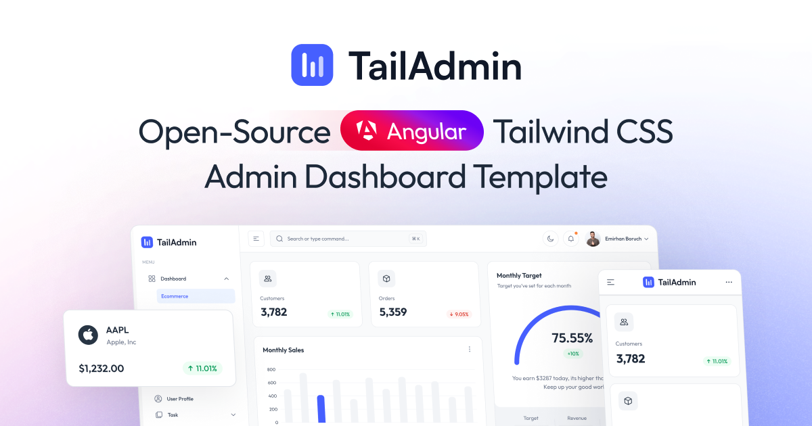

# Free Angular Tailwind Admin Dashboard Template - TailAdmin Angular

TailAdmin Angular is a **free and open-source admin dashboard template** built with **Angular** and **Tailwind CSS**. It provides developers with everything they need to create a feature-rich, data-driven **back-end, dashboard, or admin panel** for any type of web project.




With TailAdmin Angular, you’ll get access to a complete set of **dashboard UI components, elements, and ready-to-use pages** to build a modern, high-quality admin panel. Whether it’s for a **complex web application** or a **lightweight project**, TailAdmin Angular is designed to speed up development of any kind of dashboards and admin panels.

TailAdmin leverages the **powerful ecosystem of Angular 20+**, along with **TypeScript** and the utility-first styling of **Tailwind CSS v4**. Combined, they make TailAdmin Angular a perfect foundation to launch your dashboard or admin panel quickly and effectively.

TailAdmin Angular comes with essential UI components and layouts for building **feature-rich, data-driven dashboards** and **admin panels**. TailAdmin Angular is built on:

* **Angular 20+**
* **TypeScript**
* **Tailwind CSS v4**

### Quick Links

- ✨ [Visit Website](https://tailadmin.com/)
- 🚀 [Angular Demo](https://angular-demo.tailadmin.com/)
- 📄 [Documentation](https://tailadmin.com/docs)
- ⬇️ [Download](https://tailadmin.com/download)
- 🖌️ [Figma Design File (Free Edition)](https://www.figma.com/community/file/1463141366275764364)
- ⚡ [Get PRO Version](https://tailadmin.com/pricing)
---

## Feature Comparison

| Feature | Free Version | Pro Version 🌟 |
|---------|--------------|----------------|
| **Dashboards** | 1 Unique Dashboard | 7 Unique Dashboards: Analytics, Ecommerce, Marketing, SaaS, CRM, Stocks, Logistics and more (more coming soon) 📈 |
| **UI Elements and Components** | 100+ UI elements and components | Included in 500+ components and UI elements |
| **Design Files** | Basic Figma design files | Complete Figma design system file |
| **Support** | Community support| Email support |

### Other Versions

- [Next.js Version](https://github.com/TailAdmin/free-nextjs-admin-dashboard)
- [React.js Version](https://github.com/TailAdmin/free-react-tailwind-admin-dashboard)
- [Vue.js Version](https://github.com/TailAdmin/vue-tailwind-admin-dashboard)
- [Angular Version](https://github.com/TailAdmin/free-angular-tailwind-dashboard)
- [Laravel Version](https://github.com/TailAdmin/tailadmin-laravel)

## Installation

### Prerequisites

Before you start, make sure you have:

* **Node.js 20.x or later** (Node.js 20.x recommended)
* **Angular CLI** installed globally:

```bash
npm install -g @angular/cli
```

---

### Cloning the Repository

Clone the repository:

```bash
git clone https://github.com/TailAdmin/free-angular-admin-dashboard.git
```

---

### Install Dependencies

```bash
npm install
# or
yarn install
```

---

### Start Development Server

```bash
npm start
```

Then open:
👉 `http://localhost:4200`

---

## Angualr.js Tailwind Components

TailAdmin Angular ships with a rich set of **ready-to-use dashboard features**:

* **Ecommerce Dashboard** with essential elements
* Modern, accessible **sidebar navigation**
* **Data visualization** with charts and graphs
* **User profile management** and a **custom 404 page**
* **Tables** and **charts** (line, bar, etc.)
* **Authentication forms** and reusable input components
* **UI elements**: alerts, dropdowns, modals, buttons, and more
* Built-in **Dark Mode** 🕶️
* and many more


## Screen Learning

Screen Learning captures screenshots from Android Studio emulators and Android STBs over ADB, runs OCR on them, and stores a searchable screen history.

```
Angular (/screen-learning) ──JWT──▶ Spring Boot (/api/screen-learning/adb, /api/screens)
                                        │ ProcessBuilder (argument lists, no shell, timeouts)
                                        ├──▶ adb  (devices -l, connect, disconnect, getprop, wm size)
                                        └──▶ python ai-engine/capture/capture.py ──▶ adb exec-out screencap
                                                     └──▶ analyzer.py (OpenCV + Tesseract + ImageHash)
                                        ▼
               MySQL: screen_captures, screen_text_regions      Disk: <captureId>.png + <captureId>.json
```

> **OCR text regions are text detections only.** They are not confirmed clickable or interactive UI elements.

### Prerequisites (Windows)

| Component | Notes |
|---|---|
| JDK 17 | Backend uses the bundled Maven wrapper (`mvnw.cmd`). |
| Node.js 20+ | Frontend (Angular 21). |
| MySQL 8 | Database `reportingdb` (see `Backend/src/main/resources/application.properties`). |
| Python 3.10+ | Tested with Python 3.14. |
| Android SDK Platform-Tools (`adb`) | Installed with Android Studio at `%LOCALAPPDATA%\Android\Sdk\platform-tools\adb.exe`. |
| Tesseract OCR 5.x | Windows installer from [UB Mannheim](https://github.com/UB-Mannheim/tesseract/wiki). The default install path is `C:\Program Files\Tesseract-OCR\tesseract.exe`. |

Install the Python packages used by capture and analysis:

```powershell
pip install opencv-python numpy pytesseract Pillow ImageHash
```

(`ai-engine/requirements.txt` lists these plus packages for other AI-engine modules.)

### Configuration

All settings are in `Backend/src/main/resources/application.properties`. You can override each one with an environment variable.

| Property | Env var | Default | Purpose |
|---|---|---|---|
| `app.adb.path` | `ADB_PATH` | `adb` | adb executable (name on PATH or full path) |
| `app.adb.timeout-ms` | `ADB_TIMEOUT_MS` | `15000` | Timeout per adb command |
| `app.screen-learning.python-path` | `PYTHON_PATH` | `python` | Python interpreter |
| `app.screen-learning.capture.script` | `SCREEN_CAPTURE_SCRIPT` | `../ai-engine/capture/capture.py` | Capture script |
| `app.screen-learning.capture.output-dir` | `SCREEN_CAPTURE_DIR` | `data/screen-captures` | Where PNG and JSON files are stored |
| `app.screen-learning.capture.timeout-ms` | `SCREEN_CAPTURE_TIMEOUT_MS` | `90000` | Whole capture + OCR timeout |
| `app.screen-learning.ocr.tesseract-path` | `TESSERACT_PATH` | `C:/Program Files/Tesseract-OCR/tesseract.exe` | Tesseract executable |
| `app.screen-learning.ocr.lang` | `SCREEN_OCR_LANG` | `eng` | Tesseract language(s), e.g. `eng+hin` |

Relative paths resolve against the directory the backend is started from, so start it from `Backend/` or use absolute paths.

### Database

Hibernate (`spring.jpa.hibernate.ddl-auto=update`) creates the `screen_captures` and `screen_text_regions` tables on first start. To create them manually instead, run the "Screen Learning screen history" block in `Backend/update_cb_schema.sql`.

The database stores file names only. Screenshots and analyzer JSON stay in the capture directory, so back that directory up together with the database.

### Startup (PowerShell)

```powershell
# 1. Backend (from Backend/)
cd Backend
$env:ADB_PATH = "$env:LOCALAPPDATA\Android\Sdk\platform-tools\adb.exe"
$env:TESSERACT_PATH = "C:\Program Files\Tesseract-OCR\tesseract.exe"
.\mvnw.cmd spring-boot:run

# 2. Frontend (from Frontend/)
cd Frontend
npm install
npm start
```

Sign in, then open **Screen Learning** in the sidebar (`http://localhost:4200/screen-learning`).

### Connecting devices

- **Android Studio emulator:** start it from Device Manager. It appears automatically as `emulator-5554`; no connect step is needed.
- **USB device:** enable *Developer options → USB debugging*, then accept the RSA prompt on the device. The device shows as *Unauthorized* until you accept.
- **Network STB:** enable network ADB on the STB (vendor-specific; often *Developer options → Network debugging*, or `adb tcpip 5555` once over USB). Enter the STB IP (or `IP:port`) in **ADB Connections → Connect**. Only network devices can be disconnected.

### API endpoints

All endpoints require a JWT (`Authorization: Bearer <token>`).

| Method | Endpoint | Description |
|---|---|---|
| GET | `/api/screen-learning/adb/devices` | Devices from `adb devices -l`, plus model, Android version and resolution for online devices |
| GET | `/api/screen-learning/adb/devices/info?serial=` | Refresh details for one device |
| POST | `/api/screen-learning/adb/connect` | `{ "host": "192.168.1.20", "port": 5555 }` (port optional) |
| POST | `/api/screen-learning/adb/disconnect` | `{ "serial": "192.168.1.20:5555" }` |
| POST | `/api/screens/capture` | `{ "deviceId": "emulator-5554" }`. Captures, analyzes and stores the screen. |
| GET | `/api/screens?page=0&size=20&deviceId=` | Screen history, newest first (`size` 1–100) |
| GET | `/api/screens/search?text=wifi&page=0&size=20` | Case-insensitive search of OCR text (2–100 chars) |
| GET | `/api/screens/{id}` | Screen detail with OCR text regions and bounding boxes |
| GET | `/api/screens/{id}/image` | Screenshot PNG |
| GET | `/api/screens/{id}/analysis` | Raw analyzer JSON |

Errors use the standard `ApiErrorResponse` body (`status`, `error`, `message`, `path`):

| Status | Meaning |
|---|---|
| 400 | Invalid IP, serial, ID or paging; device offline |
| 401 | Missing or invalid token |
| 404 | Unknown device or screen; screenshot file missing |
| 503 | adb, Python or Tesseract unavailable, timeout, or failed capture |

### Tests

```powershell
# Backend (uses in-memory H2; never touches MySQL)
cd Backend
.\mvnw.cmd test "-Dtest=Adb*Test,ScreenLearning*Test,ScreenCapture*Test,ScreenHistory*Test,PatchmanagementApplicationTests" "-Dspring.profiles.active=h2"

# Python capture/analyzer
cd ai-engine\capture
python -m unittest test_analyzer test_capture -v

# Frontend
cd Frontend
npx ng test --watch=false --browsers=ChromeHeadless
```

Real-device and real-OCR tests run automatically when an online ADB device and Tesseract (`TESSERACT_PATH`) are available, and are skipped otherwise.

### Troubleshooting

| Symptom | Fix |
|---|---|
| `ADB executable not available. Check the 'app.adb.path' configuration.` | Set `ADB_PATH` to the full path of `adb.exe`, or add `platform-tools` to PATH. |
| Device list is empty | Run `adb devices -l` in a terminal. Start the emulator, or reconnect the STB (`adb connect <ip>:5555`). |
| Device shows **Unauthorized** | Accept the USB debugging prompt on the device, then click **Refresh**. If it doesn't appear, run `adb kill-server`. |
| Device shows **Offline** | Reboot the device or emulator, or run `adb disconnect <ip>:5555` and connect again. |
| `Connection failed: failed to connect ...` | Check the STB IP, that network ADB is enabled, and that port 5555 is reachable (firewall, VLAN). |
| `Python not available` | Set `PYTHON_PATH` to the full path of `python.exe`. |
| `Screen capture script is not configured` | Start the backend from `Backend/`, or set `SCREEN_CAPTURE_SCRIPT` to the absolute path of `ai-engine/capture/capture.py`. |
| `Analyzer dependencies missing` | Run `pip install opencv-python numpy pytesseract Pillow ImageHash` for the interpreter set in `PYTHON_PATH`. |
| `Tesseract executable not found` | Install Tesseract and set `TESSERACT_PATH`. The screenshot is still saved; only OCR is skipped. |
| `Screen capture timed out` | Increase `SCREEN_CAPTURE_TIMEOUT_MS` and/or `ADB_TIMEOUT_MS` (slow STBs or Wi-Fi). |
| No or poor OCR text | OCR works best on clear UI text; icons and stylized fonts are often missed. Add languages with `SCREEN_OCR_LANG` (the Tesseract language data must be installed). |
| Screenshot missing in history (404) | The PNG was deleted or moved from the capture directory, or the backend runs from a different working directory. |


## AI Provider (Ollama)

The backend calls Ollama's REST API (`POST /api/chat`, non-streaming) through Spring's built-in `RestClient`; no LLM SDK is used. The default model is `gemma4:31b-cloud`. It is a cloud model, but it is called through your local Ollama daemon, which forwards the request to ollama.com.

> **Model output is never trusted.** Responses are parsed strictly (unknown fields and invalid enum values are rejected) and validated in application code. If validation fails, the model gets one correction attempt; otherwise the request fails with `502`. During setup, `gemma4:31b-cloud` ignored Ollama's `format` schema and wrapped its JSON in Markdown, so the schema is also sent in the prompt and code fences are stripped before parsing.

### Windows setup

1. Install Ollama for Windows from <https://ollama.com/download>. It runs in the background on `http://localhost:11434`.
2. Sign in so the local daemon can use cloud models:
   ```powershell
   ollama signin
   ```
3. Verify the model responds:
   ```powershell
   ollama run gemma4:31b-cloud "Reply with: pong"
   ```
4. Optionally set environment variables before starting the backend. The defaults shown below are used if they are not set.
   ```powershell
   $env:OLLAMA_BASE_URL = "http://localhost:11434"
   $env:OLLAMA_MODEL    = "gemma4:31b-cloud"
   # Persist for your user (open a new terminal afterwards):
   [Environment]::SetEnvironmentVariable("OLLAMA_MODEL", "gemma4:31b-cloud", "User")
   ```

### Configuration (environment variables)

| Env var | Default | Purpose |
|---|---|---|
| `OLLAMA_BASE_URL` | `http://localhost:11434` | Ollama server. Must be `http(s)` with no embedded credentials. |
| `OLLAMA_MODEL` | `gemma4:31b-cloud` | Model name |
| `OLLAMA_API_KEY` | *(empty)* | Only needed when calling `https://ollama.com` directly. Sent as a Bearer token, only over https or to localhost, and never logged. |
| `OLLAMA_CONNECT_TIMEOUT_MS` | `5000` | TCP connect timeout |
| `OLLAMA_REQUEST_TIMEOUT_MS` | `120000` | Timeout for a whole request |
| `OLLAMA_MAX_ATTEMPTS` | `2` | Attempts for transient errors (HTTP 429/502/503/504) |

### Endpoints (JWT required)

| Method | Endpoint | Description |
|---|---|---|
| GET | `/api/ai/health` | Checks Ollama is reachable (`/api/version`) and the model exists (`/api/show`). Returns `200` when UP, `503` with diagnostics when DOWN. |
| GET | `/api/ai/health?probe=true` | Also sends a tiny chat request to verify the model can generate. This uses cloud quota. |
| POST | `/api/ai/test-plans/draft` | `{ "goal": "...", "context": "optional on-screen text" }` returns a validated draft test plan. The plan is a suggestion and is never executed automatically. |

Cloud models are **not** listed by `/api/tags`, so the health check uses `/api/show` to confirm the model exists.

| Error | HTTP | Typical cause |
|---|---|---|
| `CONNECTION_FAILED` | 503 | Ollama isn't running, or `OLLAMA_BASE_URL` is wrong |
| `MODEL_NOT_FOUND` | 503 | Model name is wrong, or a local model hasn't been pulled |
| `UNAUTHORIZED` | 503 | Cloud model used without `ollama signin` (or a bad `OLLAMA_API_KEY`) |
| `TIMEOUT` | 504 | Model took longer than `OLLAMA_REQUEST_TIMEOUT_MS` |
| `INVALID_OUTPUT` | 502 | Model output failed validation twice |

### Tests

```powershell
cd Backend
# Unit + HTTP tests (stub server; no Ollama needed)
.\mvnw.cmd test "-Dtest=Ollama*Test,StructuredChatServiceTest,AiApiTest" "-Dspring.profiles.active=h2"
# Also run the live tests against your configured Ollama/model (opt-in; uses cloud quota)
$env:OLLAMA_LIVE_TEST = "true"; .\mvnw.cmd test "-Dtest=OllamaLiveTest"
```

### Troubleshooting

| Symptom | Fix |
|---|---|
| `Cannot connect to Ollama ... Is Ollama running?` | Start Ollama from the Start menu, or run `ollama serve`. Check with `curl http://localhost:11434/api/version`. |
| `Model 'gemma4:31b-cloud' is not available` | Check the name with `ollama show gemma4:31b-cloud`. For local models, run `ollama pull <model>`. |
| `Ollama rejected the request (401)` | Run `ollama signin` (cloud models need an ollama.com account). |
| `Ollama did not respond within 120s` | Increase `OLLAMA_REQUEST_TIMEOUT_MS`, or check your network or cloud status. |
| `Model output failed validation` | Retry; check the backend log for the specific validation errors. |


## Screen Exploration (Phase 2)

Open **Screen Exploration** in the sidebar (`/screen-exploration`). It records how screens connect: *source screen → remote key → destination screen*.

### How it works

1. **Act:** one allow-listed key is sent with `adb shell input keyevent`. Only D-pad ↑ ↓ ← →, OK (`DPAD_CENTER`), Back and Home exist; there is no text input or shell access.
2. **Capture:** the Phase 1 pipeline runs (`capture.py` → `analyzer.py` → `screen_captures`). Every observation is saved in the screen library.
3. **Identify:** the capture is matched against known screens for that device.
   - Text-rich screens match on OCR text, so moving focus with the D-pad keeps you on the same screen. The status bar and numbers are ignored, so a changing clock doesn't create a new screen.
   - Screens with little text match on perceptual hash.
   - No match creates a new **screen node**.
4. **Interpret (new screens only):** Gemma (`OLLAMA_MODEL`) names the screen and rates its risk.
   - The screenshot is sent in Ollama's image format only if `/api/show` reports the `vision` capability.
   - It is recorded as `IMAGE` only if the text the model reports seeing overlaps the OCR text. Otherwise it is recorded as `IMAGE_UNVERIFIED`.
   - Without vision, the prompt says no image is attached and only OCR text and metadata are used (`TEXT`).
   - If Ollama fails, exploration continues with the OCR-based label.
5. **Record:** a step is written to `exploration_steps`, and the edge in `screen_transitions` is created, or its count incremented if it already exists.

### Safety and bounds

| Control | Behaviour |
|---|---|
| Step / time limits | Default 30 steps / 600 s; hard caps of 200 steps / 1800 s (configurable). Requests can never exceed the caps. |
| One session per device | A second session on the same device returns 409. |
| Stop | The **Stop** button ends a manual session immediately; an auto session stops after its current step. |
| Destructive guard | OK is refused on any screen containing words like *reset, erase, delete, uninstall, purchase, buy, sign out, confirm…* (override with property `app.exploration.blocked-keywords`, comma-separated, or env var `APP_EXPLORATION_BLOCKEDKEYWORDS`). OK is also refused on screens rated `DESTRUCTIVE`. Blocked steps are recorded but nothing is sent. |
| LLM can only restrict | Gemma's risk rating can only raise a screen's risk, never lower it. Its output never chooses which key to press. |
| Auto mode | OK and Home are off unless enabled per session. Each focus state is explored once (duplicate detection). The session stops when nothing new is reachable (`COMPLETED`), after 10 steps without progress (`STALLED`), or after 3 consecutive failures (`FAILED`). |
| Restart | Sessions left open when the backend stopped are marked `INTERRUPTED` on startup. |

### API (JWT required)

| Method | Endpoint | Description |
|---|---|---|
| POST | `/api/exploration/sessions` | `{ deviceId, mode: "MANUAL"\|"AUTO", maxSteps?, maxDurationSeconds?, settleMs?, allowSelect?, allowHome? }` |
| GET | `/api/exploration/sessions?page=&size=` | Recent sessions |
| GET | `/api/exploration/sessions/{id}` | Session status |
| POST | `/api/exploration/sessions/{id}/actions` | `{ "action": "DPAD_DOWN" }`. Manual sessions only. |
| POST | `/api/exploration/sessions/{id}/stop` | Stop a session (idempotent) |
| GET | `/api/exploration/sessions/{id}/steps` | Transition history, newest first |
| GET | `/api/exploration/graph?deviceId=` | Screen nodes and transition edges for a device |
| GET | `/api/exploration/nodes/{id}` | Screen node detail (label, type, risk, how it was interpreted) |

The tables are `screen_nodes`, `screen_transitions`, `exploration_sessions` and `exploration_steps`. Hibernate creates them automatically; the SQL is in the "Phase 2" block of `Backend/update_cb_schema.sql`.

### Tests

```powershell
cd Backend
# Simulated TV device + H2 (no device or Ollama needed)
.\mvnw.cmd test "-Dtest=ScreenFingerprintTest,DestructiveActionGuardTest,ScreenInterpretationServiceTest,Exploration*Test" "-Dspring.profiles.active=h2"
# Live: real emulator + OCR + Gemma image input (sends DPAD_DOWN and BACK, then HOME)
$env:OLLAMA_LIVE_TEST = "true"; $env:TESSERACT_PATH = "C:\Program Files\Tesseract-OCR\tesseract.exe"
.\mvnw.cmd test "-Dtest=ExplorationLiveTest" "-Dspring.profiles.active=h2"
```

### Limitations

- Screen identity is per device serial and per screen, not per focused item. Focus positions are tracked only in memory during auto runs.
- The destructive guard checks text on the whole screen, not just the focused item. This is conservative: OK is also blocked on harmless items of such screens.
- Each step stores a full screenshot in the Phase 1 library (about 1 MB per step on phones). Plan disk space for long sessions.


## AI Test Planner

Open **AI Test Planner** in the sidebar (`/test-planner`). Enter a natural-language goal, choose a device, and optionally a start screen. The planner writes a draft test plan grounded in that device's explored screens. **Plans are never executed**; they are saved as `DRAFT` for human review.

### How a plan is produced

1. **Retrieve:** known screens are loaded for the device, with their OCR text from the representative capture, risk level and observed transitions. If there are more than 60 screens, the start screen, its neighbours and the screens most related to the goal are selected. The snapshot is capped at 60,000 characters.
2. **Prompt:** the snapshot is sent to Ollama `/api/chat` (`stream: false`, `temperature: 0`). The JSON Schema in `resources/ai/test-plan.schema.json` is sent as `format` and also included in the prompt. Screen text is marked as untrusted data.
3. **Validate every response:**
   - Extract the JSON object; Markdown fences are allowed, but multiple objects or arrays are rejected.
   - Check it against the **JSON Schema**: required fields, enums, ranges and `additionalProperties: false`, so fields such as `"result": "PASSED"` are rejected.
   - Map it strictly to typed objects.
   - Apply structural rules: steps numbered 1..n, `UNSUPPORTED` steps must say what is needed, assertions must reference real steps.
4. **Retry:** invalid output is sent back to the model with the exact errors, up to `AI_PLANNER_MAX_ATTEMPTS` (default 3, hard cap 3) calls in total. If it still fails, the request returns `502` and nothing is saved.
5. **Review against knowledge:** the server, not the model, computes flags and per-step evidence:

| Flag | Severity | Meaning |
|---|---|---|
| `UNSUPPORTED_ACTION` | ERROR | The goal needs something the platform cannot do (text input, power, network...) |
| `DESTRUCTIVE_STEP` | ERROR | SELECT on a screen marked DESTRUCTIVE |
| `UNKNOWN_SCREEN` | WARNING | A screen id that was never explored, or an unknown destination |
| `UNKNOWN_LOCATOR` | WARNING | Target text not seen by OCR on that screen |
| `UNOBSERVED_TRANSITION` | WARNING | source → action → destination was never observed |
| `SEQUENCE_GAP` | WARNING | A step starts on a different screen than the previous step ends on |
| `NO_SCREEN_KNOWLEDGE` | WARNING | The device has not been explored |

Step evidence is `OBSERVED` only when that exact transition exists in `screen_transitions`. Plans with ERROR flags can't be approved.

Plan actions: `DPAD_UP/DOWN/LEFT/RIGHT`, `SELECT`, `BACK`, `HOME`, `WAIT`, `ASSERT_SCREEN`, `ASSERT_TEXT_VISIBLE`, `UNSUPPORTED`. Each step has a target, from/expected screen, expected state, `timeoutMs` (500–60000) and `onFailure`. Each plan also has preconditions, assertions, failure handling (retries, recovery) and the model's assumptions.

### API (JWT required)

| Method | Endpoint | Description |
|---|---|---|
| POST | `/api/ai/test-plans` | `{ goal, deviceId, startScreenId?, maxSteps? (1-40) }`. Generates and saves a DRAFT. |
| GET | `/api/ai/test-plans?page=&size=&deviceId=&status=` | List plans |
| GET | `/api/ai/test-plans/{id}` | Plan, flags, step evidence, knowledge snapshot |
| POST | `/api/ai/test-plans/{id}/review` | `{ decision: "APPROVED"\|"REJECTED"\|"DRAFT", notes? }` |

Plans are stored in `ai_test_plans`; the SQL is in the "AI test planner drafts" block of `Backend/update_cb_schema.sql`. The earlier stateless `POST /api/ai/test-plans/draft` endpoint is unchanged; it is not grounded in screen knowledge and saves nothing.

### Tests

```powershell
cd Backend
.\mvnw.cmd test "-Dtest=PlanReviewerTest,AiTestPlannerServiceTest,AiTestPlanApiTest,StructuredChatServiceTest" "-Dspring.profiles.active=h2"
# Live against gemma4:31b-cloud (opt-in; uses cloud quota)
$env:OLLAMA_LIVE_TEST = "true"; .\mvnw.cmd test "-Dtest=AiTestPlannerLiveTest" "-Dspring.profiles.active=h2"
```


## Changelog

### v1.0.2 (2025-12-30)

- **Upgrade**: Successfully upgraded project to **Angular 21**.
- **New Feature**: Implementing **Dynamic API Keys** management.
  - Added functionalities to **Add**, **Edit**, **Delete**, and **Regenerate** API Keys.
- **Enhancement**: Integrated **Flatpickr** date range picker in `StatisticsChartComponent`.
- **Bug Fix**: Resolved `NG0100` ExpressionChangedAfterItHasBeenCheckedError in `PieChartTwoComponent`.
- **Bug Fix**: Fixed `NG8113` warning in `AddApiKeyModalComponent` by removing unused imports.
- **Cleanup**: Removed unused imports and optimized code across various components.

